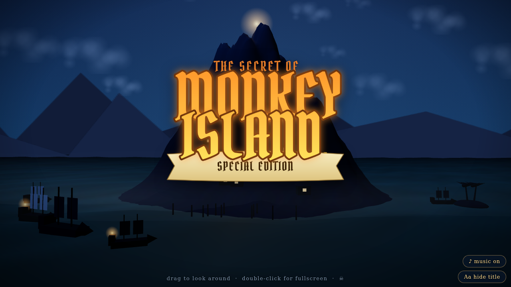

# Monkey Island Intro — Interactive 3D

A fan-made, browser-based **3D recreation of *The Secret of Monkey Island: Special Edition* intro scene** — with the real main title theme, played entirely by a Web Audio synthesizer. No assets to download: it's a single self-contained HTML file.

**▶ [Live demo](https://vesanieminen.github.io/Monkey-Island-intro/)**



## What's in it

- 🏝️ **The island as a real 3D scene** — heightfield mountain with glowing skull-cave at the peak, wave-shaded ocean with moonlight sparkles, shipwrecks bobbing on the swells, a village of huts with flickering window lights, dock pilings, palm islet, drifting clouds and sea mist, twinkling star shader, and layered mountain silhouettes with true parallax
- 🎵 **The actual Main Title Theme by Michael Land** (1990 Lucasfilm Games) — note data was extracted from the original General MIDI arrangement and is performed live by a small synth ensemble (steel pans, marimba, bass, bells, flute, percussion). No audio files, no autoplay surprises
- 🏴‍☠️ **The classic title logo** as a crisp DOM overlay sized to match the original artwork — never occluded, toggleable
- 🎬 A proper **start screen**: just a button over the frozen scene; one click starts the animation and music

## Controls

| Action | How |
| --- | --- |
| Start | Click **"☠ Start the adventure"** |
| Look around | Drag anywhere (slow cinematic sway when idle) |
| Fullscreen | Double-click (when opened directly in a browser) |
| Music | **♪ music on / ♪ music off** button (mute keeps playing) |
| Title logo | **Aa hide title / Aa show title** button |

The page fills the entire browser window when opened standalone, and fits its container when embedded.

## Under the hood

- **One file, no build step** — everything is inlined; Three.js and the *Pirata One* font load from CDNs
- **Island**: analytic heightfield (gaussian peaks + noise, trimmed shore) on a 104×104 grid with baked vertex colors
- **Water**: custom GLSL shader — sum-of-sines displacement, analytic normals, Blinn-Phong moonlight, exponential fog
- **Logo**: drawn on a 2D canvas (text + banner ribbon), positioned as an HTML overlay so the camera can never hide it
- **Music engine** (`Calypso`): the embedded MIDI data (3,928 notes) is flattened into a sorted event stream and scheduled through the Web Audio clock with a look-ahead scheduler, then synthesized per channel:

  | MIDI ch | Role in the 1990 arrangement | Instrument voice |
  | --- | --- | --- |
  | 1 | high counter-line | soft steel pan (distant) |
  | 2 | main melody lead | steel pan + ⅛-note slap echo |
  | 3 | staccato chord comping | dry mallet stab, lowpassed |
  | 4 | rhythm chord stabs | marimba |
  | 5 | bass | triangle + sub sine, lowpass |
  | 6 | bell accents | vibraphone-style partials |
  | 7 | counter phrases | breathy flute with vibrato |
  | 9 | percussion | kick, side-stick, congas, woodblock — exactly the set the MIDI actually uses |

## Running locally

Just open `index.html` in a modern browser (internet needed for the Three.js/font CDNs), or:

```bash
python3 -m http.server
```

## Deployment

Served by GitHub Pages from the repository root (`main` branch). Push to `main` and the site updates automatically.

## Credits & disclaimer

- Music: *The Monkey Island Theme* by Michael Land (© Lucasfilm Entertainment Company Ltd.). Note data is embedded from a 1990-era GM transcription for this **non-commercial fan project**; no audio recordings or game assets are distributed.
- *Monkey Island* and *The Secret of Monkey Island* are trademarks of their respective owners. This project is unofficial and unaffiliated.
- Built with [Three.js](https://threejs.org/) · font: [Pirata One](https://fonts.google.com/specimen/Pirata+One)
